# Desk Watch

A compact desk console built around an **Arduino UNO R3** and a **Grove Base Shield**. It is more than a thermometer: one small box, one menu, nine apps. Every module plugs in with a standard Grove cable, no soldering.

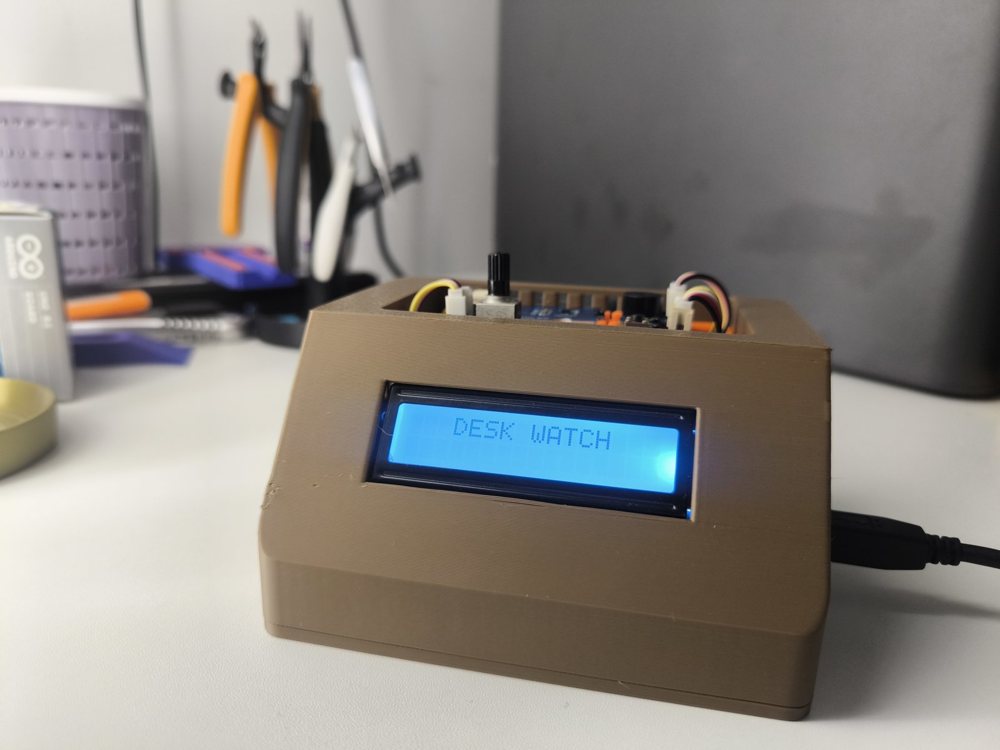

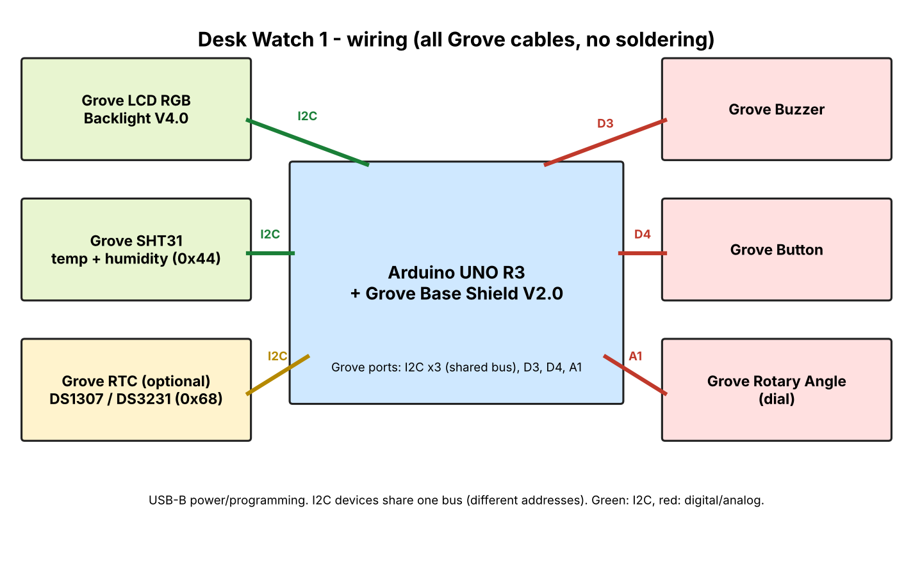

## What it does

- Temperature and humidity on a 16x2 RGB LCD (SHT31 sensor), with adjustable HIGH / LOW thresholds: the screen turns red, blue or green and the buzzer warns you.
- Menu of 9 apps: Temp & Hum, Timer, Stopwatch, Counter, Dice, Chess clock, Settings, Manual, Home.
- Timer: Pomodoro from 1 minute to 4 hours.
- Dice: D2 (coin flip), D4, D6, D8, D10, D12, D20, D30 (pick a student in class) and D100.
- Chess clock: 10 time controls from 1+0 to 60+0, with increment (default 5+3).
- Settings: startup sound, volume, language (English by default, plus French, Spanish and German), home page, night mode, automatic sleep, backlight.
- Optional RTC module (DS1307 or DS3231): clock and alarm, with an automatic night mode.
- A 27-page manual built into the firmware, readable on the LCD.

## Hardware

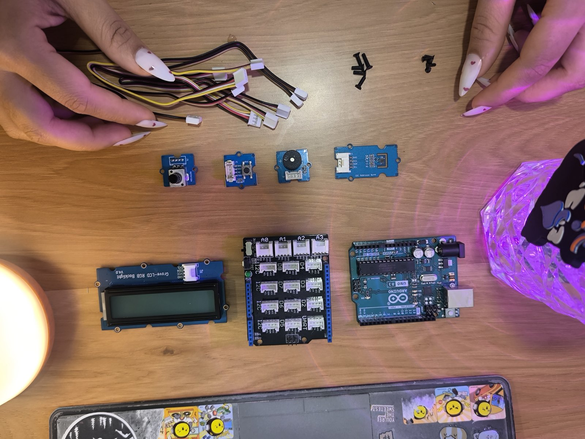

| Part | Connection |
|---|---|
| Arduino UNO R3 + Grove Base Shield V2.0 | USB-B for power and programming |
| Grove LCD RGB Backlight V4.0 (16x2) | I2C |
| Grove SHT31 temperature and humidity sensor (0x44) | I2C |
| Grove RTC, DS1307 or DS3231 (0x68), optional | I2C |
| Grove Buzzer | D3 |
| Grove Button | D4 |
| Grove Rotary Angle sensor (dial) | A1 |

The LCD, the SHT31 and the RTC share the same I2C bus (different addresses), so the order of the I2C ports does not matter.

## Software

1. Open `Desk_Watch_1/Desk_Watch_1.ino` in the Arduino IDE.
2. Install the **"Grove - LCD RGB Backlight"** library (Library Manager). No other library is needed: the SHT31 and the RTC are read directly over I2C.
3. Select *Arduino Uno* and upload.

### Birthday edition

A separate firmware edition adds Happy Birthday immediately after Chess clock, bringing the menu to 10 entries. Open `Desk_Watch_1_birthday/Desk_Watch_1_birthday.ino` in the Arduino IDE. Install the same Grove LCD library above and select Arduino Uno. The sketch is also attached to the [v1.0.0-birthday release](https://github.com/PrBelamine/desk-watch/releases/tag/v1.0.0-birthday).

The sketch uses about 93 % of the UNO's flash and about 22 % of its RAM, so there is little room left for new pages. Ideas to save flash space are welcome. The code is commented in English so it can be read and modified, for example in a classroom.

## Photos

| | |
|---|---|
| 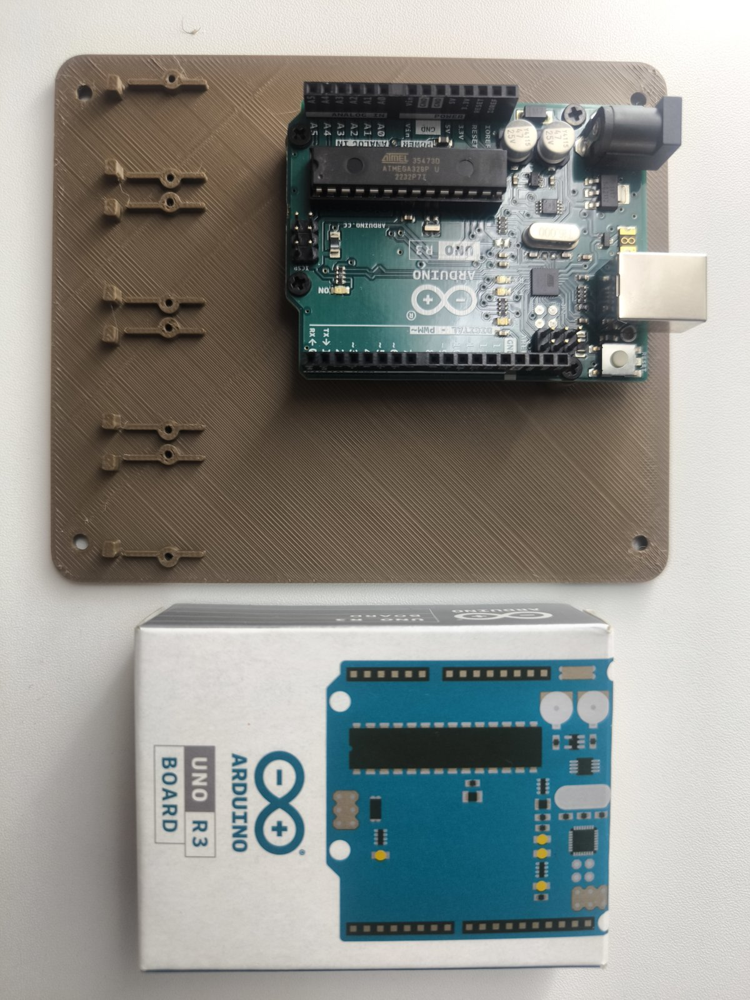 | 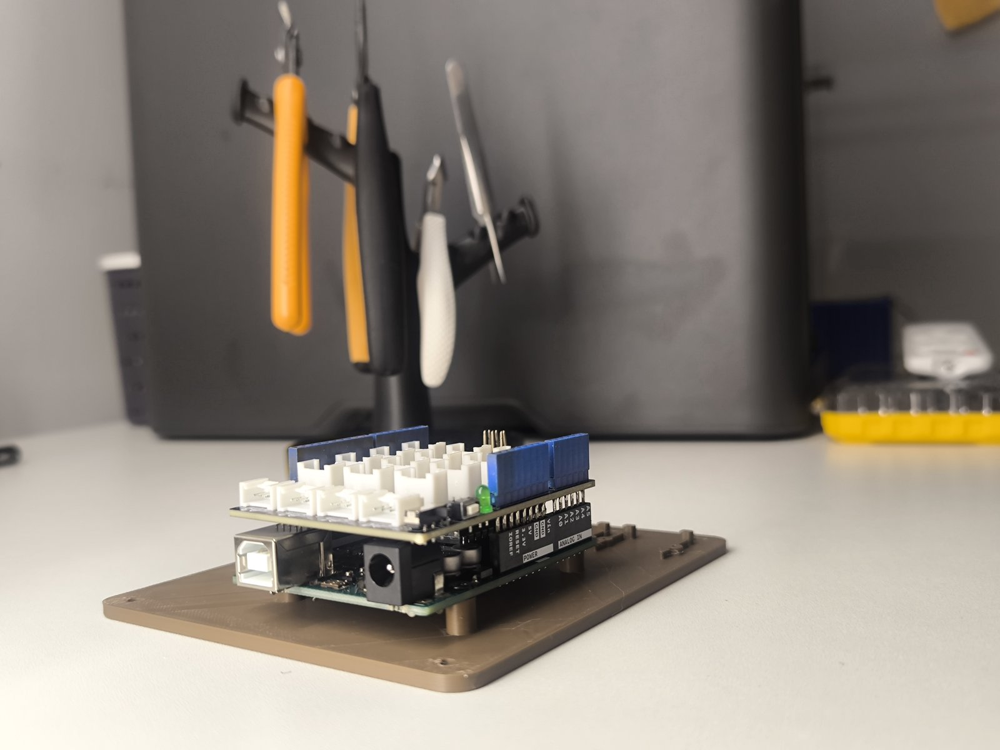 |
| 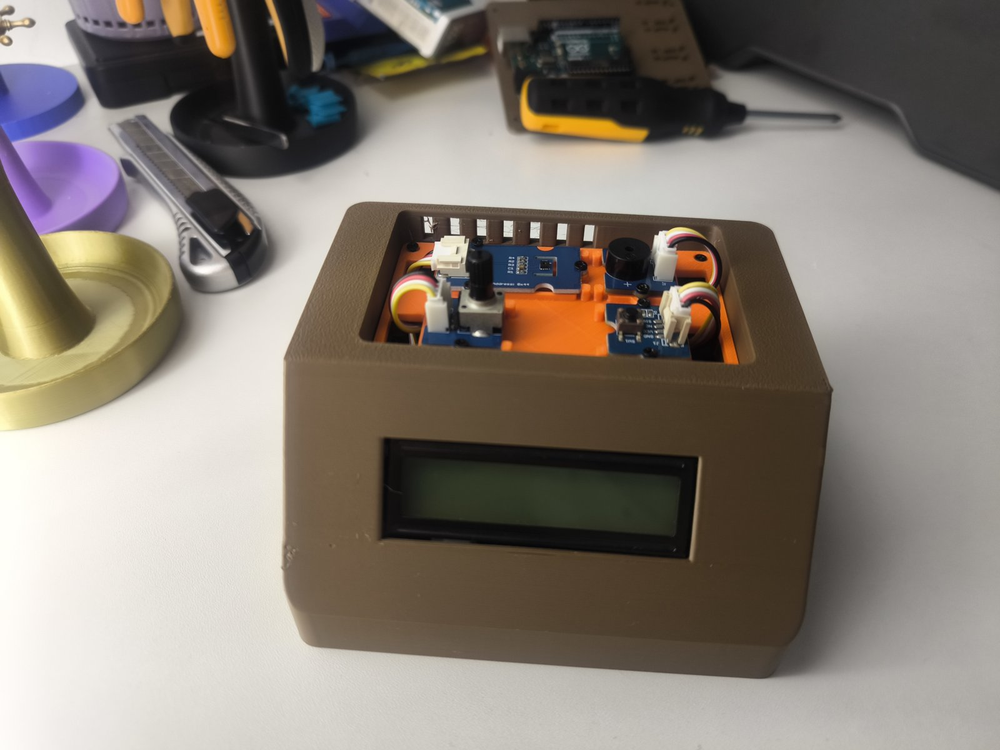 | 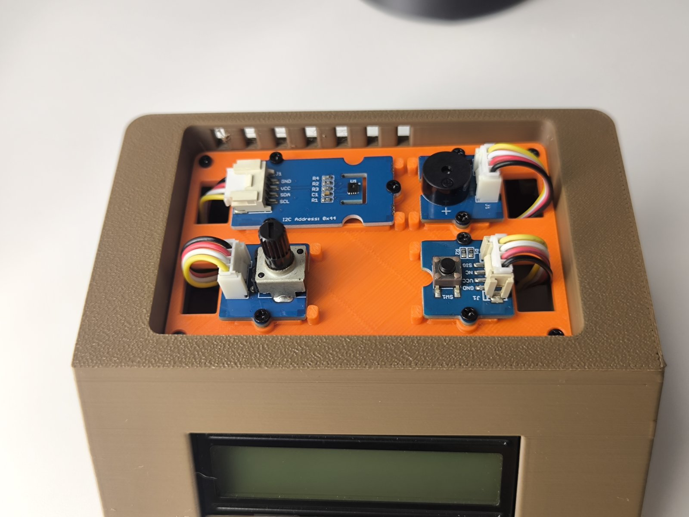 |
| 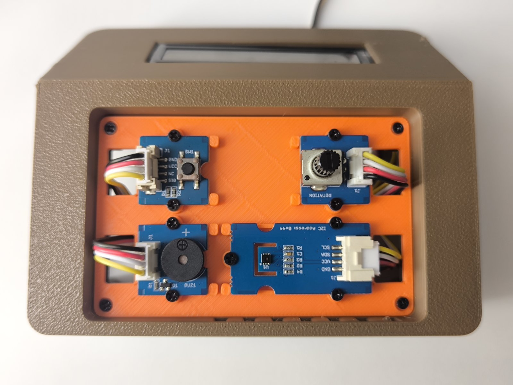 | 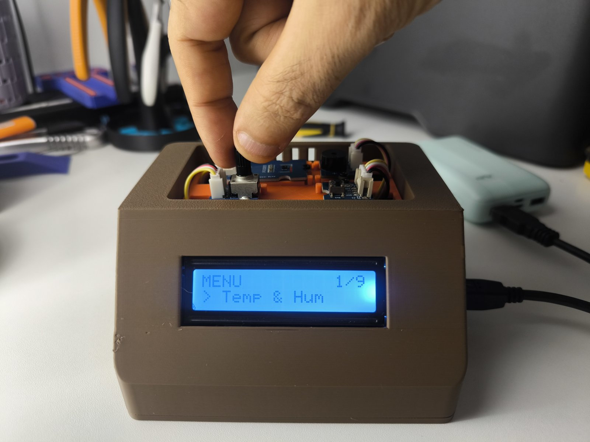 |

Menu apps in use:

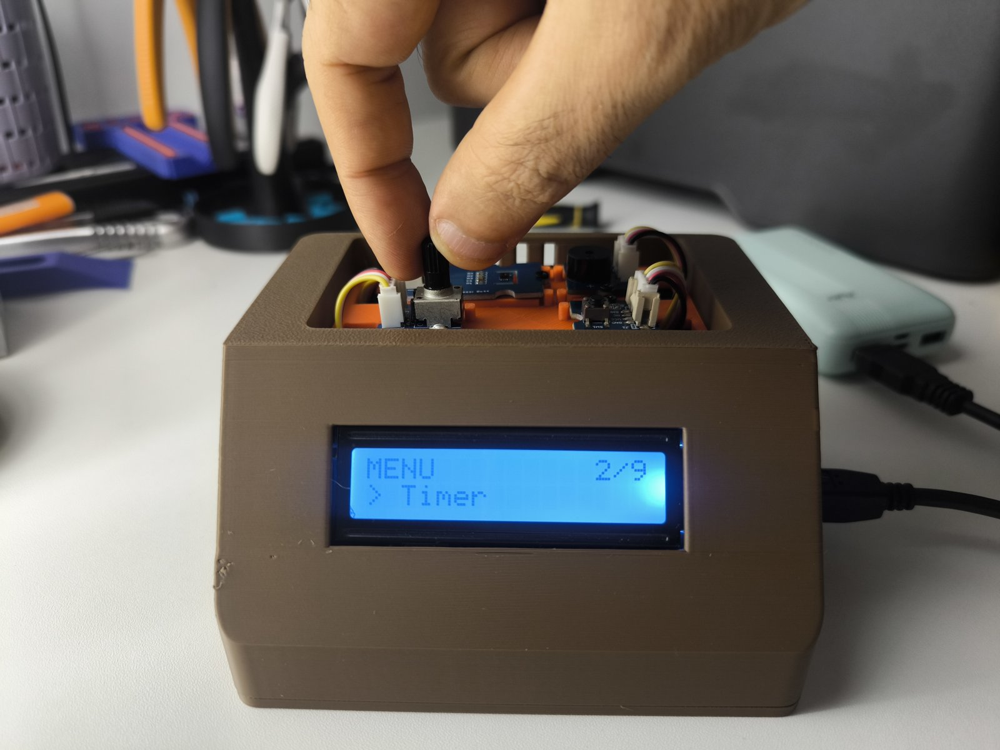 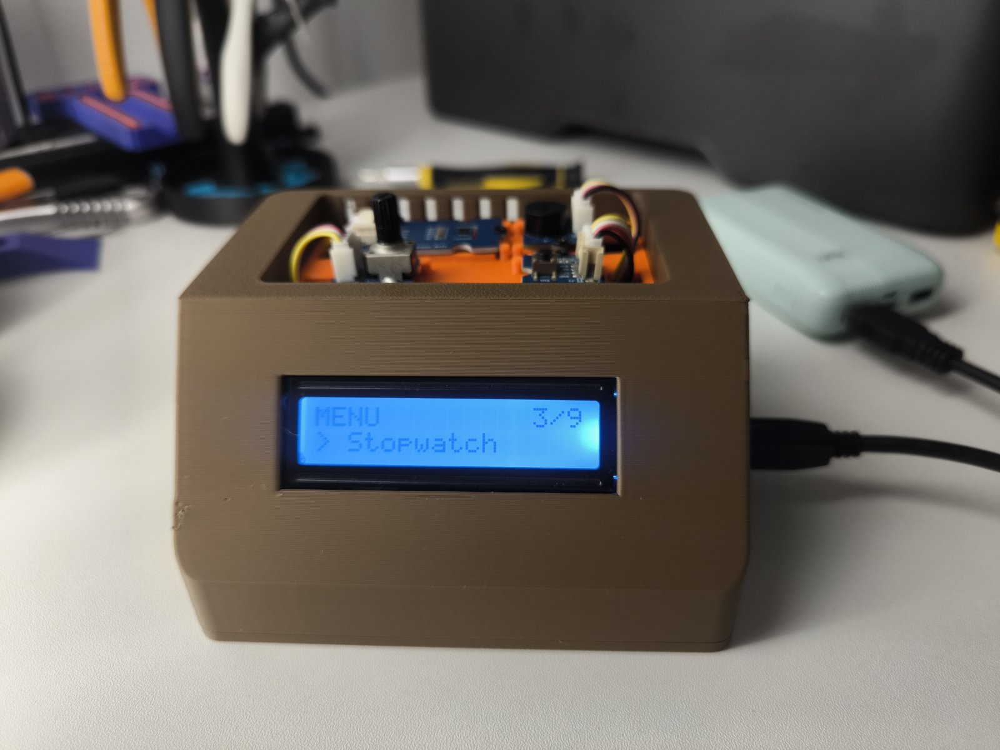
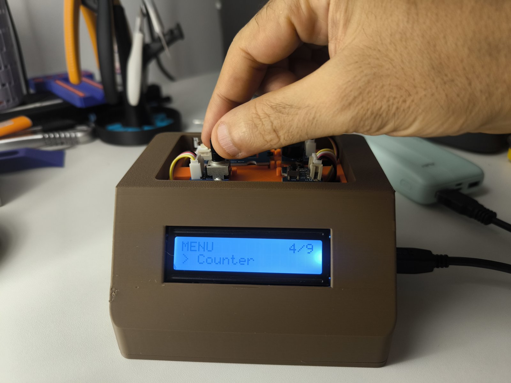 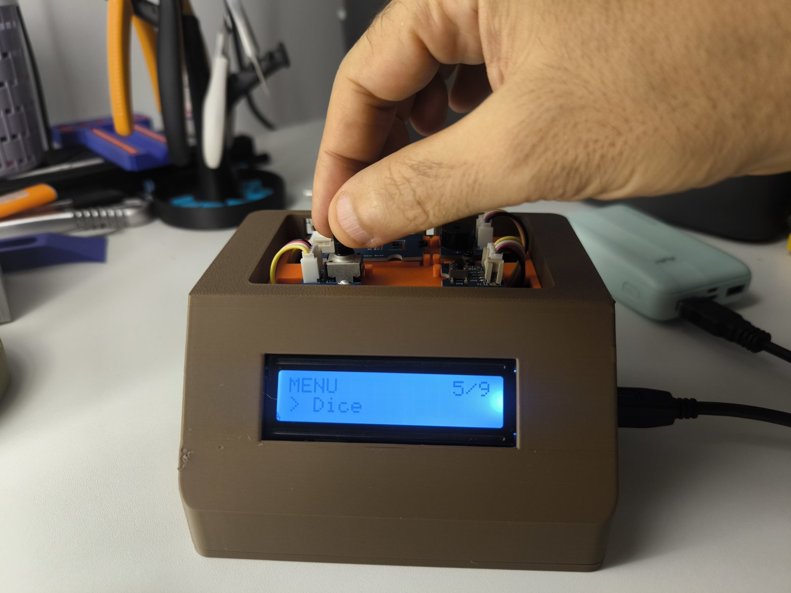 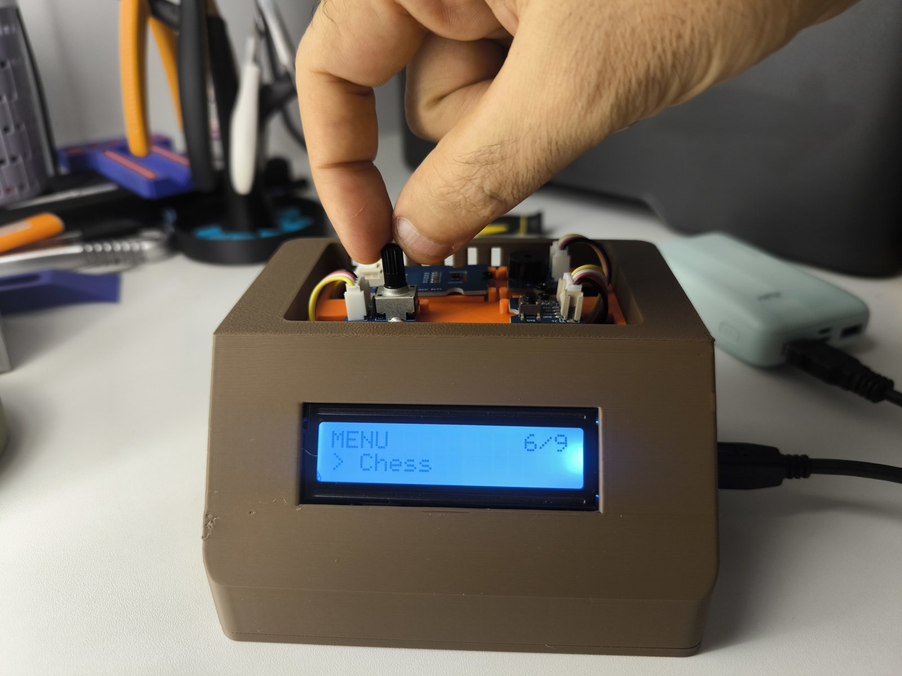

## Documentation

[User guide (PDF)](docs/Desk_Watch_1_User_Guide.pdf)

## 3D-printed case

The case (base, shell, tray) is designed for a Bambu Lab printer and printed in PLA. The 3D files, print profiles and photos are only on MakerWorld:

https://makerworld.com/models/3451026

## Also published on

- Hackster: https://www.hackster.io/belaminelfay/desk-watch-arduino-uno-multi-app-desk-console-0709c7
- Arduino Forum (Showcase): https://forum.arduino.cc/t/desk-watch-an-arduino-uno-desk-console-with-9-apps-climate-alerts-pomodoro-dice-chess-clock/1464130
- Arduino Project Hub (submitted, waiting for review)

## License

The sketch is released under the **GNU General Public License v3.0** (see `LICENSE`).

Made by a teacher at Pr. BELAMINE MakerLab, so it also works well as a classroom electronics and coding project, and as a practical desk tool.
