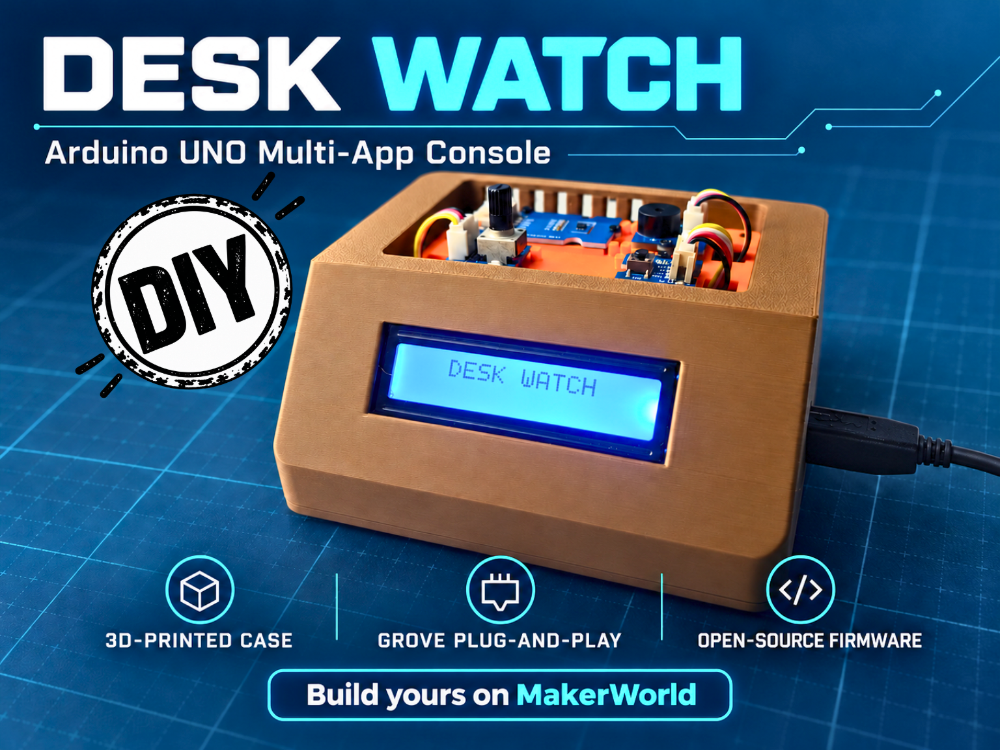
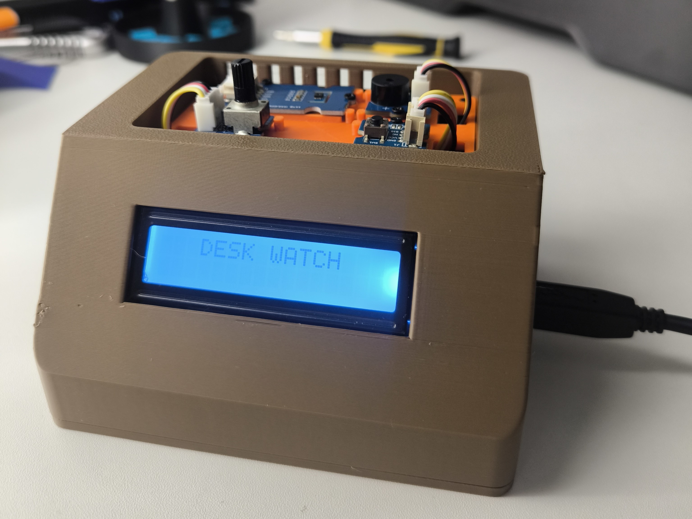
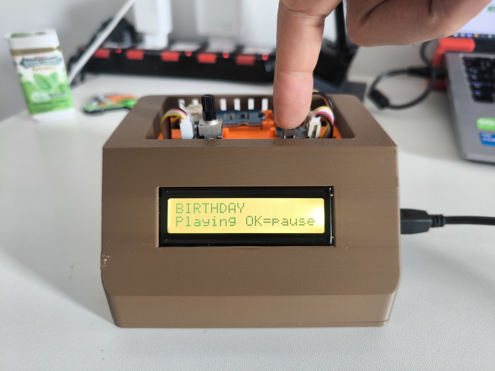

# Desk Watch — MELODY & TEACHER Editions




An Arduino UNO R3 desk console with Grove modules, a 16×2 RGB LCD, one button and one rotary dial. It combines climate monitoring, timekeeping and desk tools. **MELODY and TEACHER are now built on the same base as the JOY STUDENT edition (same apps, same menu), controlled with a button and a dial instead of a joystick. TEACHER Edition adds an EXAM app that combines an exam countdown and paper collection on one screen.**

## Choose your edition

| Edition | Menu | Includes |
|---|---:|---|
| **MELODY** | 10 entries | Climate display with five pages, Pomodoro timer, counter, stopwatch, alarm, dice, chess clock, Melody player, settings and sleep mode |
| **TEACHER** | 11 entries | All MELODY features plus **EXAM** |

Each edition ships in **two language builds: FR (French) and EN (English)**. In a given build, the LCD interface and the code comments use that single language, and there is no language choice in Settings. Keeping one language frees about 6 KB of program storage on the Arduino UNO. **Versions in other languages (Spanish, German...) and other editions will be created on request: tell us in the comments.**

| Edition | French build (FR) | English build (EN) |
|---|---|---|
| MELODY | [MELODY FR](Desk_Watch_1_MELODY/Desk_Watch_1_MELODY_Edition_FR/Desk_Watch_1_MELODY_Edition_FR.ino) | [MELODY EN](Desk_Watch_1_MELODY/Desk_Watch_1_MELODY_Edition_EN/Desk_Watch_1_MELODY_Edition_EN.ino) |
| TEACHER | [TEACHER FR](Desk_Watch_1_TEACHER/Desk_Watch_1_TEACHER_Edition_FR/Desk_Watch_1_TEACHER_Edition_FR.ino) | [TEACHER EN](Desk_Watch_1_TEACHER/Desk_Watch_1_TEACHER_Edition_EN/Desk_Watch_1_TEACHER_Edition_EN.ino) |

MELODY and TEACHER each live in their own folder (`Desk_Watch_1_MELODY`, `Desk_Watch_1_TEACHER`), with one subfolder per language (`..._FR` and `..._EN`). Keep each `.ino` inside its identically named folder when opening it in Arduino IDE. **The RTC module (DS1307 or DS3231) is required in MELODY**, as in JOY STUDENT: the clock, the alarm and the automatic night mode need it. Earlier releases and Git history retain previous firmware versions; the four files above are the current edition sources. The embedded LCD manual has been removed.

## MELODY controls

| Control | Action |
|---|---|
| **Dial** | Scroll the menu, change a value. Its position selects the entry or the value. |
| **Short press** | OK (confirmed 0.3 s after release, to leave room for a double click). |
| **Double click** | Page-specific action: thresholds (Temp & Hum), reset (timer, stopwatch), disable (alarm), pause (chess clock), menu (dice, melody). |
| **Long press** (0.8 s or more) | Back: menu, cancel, previous step. |
| **Sleep mode** | Last entry of the menu. A press or a turn of the dial wakes the device. |

MELODY apps:

- **Temp & Hum:** RTC time and background letters on the first row; temperature, humidity and OK on the second. The dial changes page: readings, minimum, maximum, average and an automatic cycle every 3 s. A double click sets the four thresholds (Tmin, Tmax, Hmin, Hmax). The RGB backlight turns red when too high, blue when too low and green when OK.
- **Timer (Pomodoro):** 1 min to 4 h, 5 min breaks and a 15 min long break every fourth session. Once started, turning the dial opens the menu without stopping the countdown.
- **Counter:** each short press adds one immediately. Turning the dial opens an action screen: short press = −1, double click = reset, 5 s without an answer = cancel.
- **Stopwatch:** short press = start or stop, double click = reset.
- **Alarm:** short press = enable and set (hours, minutes, ringtone, volume), double click = disable. Eight ringtones with preview. Any press or turn of the dial stops a ringing alarm for the day.
- **Dice:** D2, D4, D6, D8, D10, D12, D20, D30 and D100.
- **Chess clock:** eleven time controls from 1+0 to 60+0, including 5+3 and the new 20+0. Short press passes to the other player; double click pauses.
- **Melody player:** Birthday, Für Elise, Mario Bros and Tetris.
- **Settings (8):** brightness, volume (five levels), boot sound, auto sleep, night mode, set time, favorite and factory reset. The boot sound is off by default.
- **Night mode:** No / Auto (10 pm to 6 am, with the RTC) / Yes: brightness reduced to 8 %, alert beeps muted; the alarm still rings.

## EXAM: countdown and paper collection (TEACHER)

This app grew from a classroom use case: a **35-minute exam with 24 students**, using the countdown and the counter as each paper was handed in. TEACHER brings these two tasks together.

1. Choose **1–240 minutes** with the dial and click.
2. Choose **1–99 expected papers** and click.
3. Check the summary and click to start. Initial suggestions are **35 min / 24 papers**.

Example LCD layout:

```text
EXAMEN     34:59
Papers     00/24
```

Every short press counts a paper immediately. Two quick presses count two papers; a double click does not reset the count. The counter stops at the expected total.

A **long press (0.8 s or more)** opens the exam controls:

- Back to collection.
- Subtract one paper to correct an extra press.
- Pause or resume the countdown.
- Add five minutes, capped at four hours remaining.
- End the exam, with confirmation.
- Open the main menu while the exam countdown continues in the background.

At zero, two short beeps sound once and collection remains available. At the expected paper count, the screen turns green. The final message alternates with **actual elapsed working time, excluding pauses**; the paper count stays visible. Elapsed time freezes at the last expected paper or at expiry. Collection after expiry does not increase it.

```text
TOTAL      35:00
Papers     24/24
```

Ending manually shows a stable summary. Another click opens setup for the next exam. Automatic sleep is suspended during the session; manual sleep is started from the Sleep mode menu entry. The running session is held in RAM and does not survive power loss or reset.

After the startup introduction, **TEACHER opens the menu at Exam, 1/11**, regardless of the dial's initial position. Turning the dial enables navigation. EXAM can also be chosen as the start-up page in Settings > Favorite.

Detailed instructions: [French guide](Desk_Watch_1_TEACHER/Desk_Watch_1_TEACHER_Edition_FR/README_FR.md) · [English guide](Desk_Watch_1_TEACHER/Desk_Watch_1_TEACHER_Edition_EN/README_EN.md).

## Menu tree

MELODY (10 entries):

```text
Desk Watch
├── Temp & Hum
├── Timer
├── Counter
├── Stopwatch
├── Alarm
├── Dice
├── Chess clock
├── Melody
├── Settings
└── Sleep mode
```

In MELODY the favorite page is chosen in Settings (Menu by default, Temp & Hum, Timer, Stopwatch, Counter, Dice or Chess clock) and sets the page shown at start-up.

TEACHER (11 entries):

```text
Desk Watch
├── Exam
├── Temp & Hum
├── Timer
├── Counter
├── Stopwatch
├── Alarm
├── Dice
├── Chess clock
├── Melody
├── Settings
└── Sleep mode
```

In TEACHER the favorite list also offers Exam.

The alarm and clock require the RTC; EXAM does not.

## Hardware and wiring


| Part | Connection |
|---|---|
| Arduino UNO R3 + Grove Base Shield V2.0 | USB for power/programming |
| Grove LCD RGB Backlight V4.0, 16×2 | I2C |
| Grove SHT31/SHT40 temperature/humidity sensor, 0x44 | I2C |
| DS1307 or DS3231 RTC, 0x68 (required: clock, alarm and automatic night mode) | I2C |
| Grove buzzer | D3 |
| Grove button | D4 |
| Grove rotary angle sensor | A1 |

Modules use Grove cables; no soldering is needed. LCD, SHT31/SHT40 and RTC share the I2C bus at different addresses. The current driver uses the earlier module command set at I2C 0x44; SHT40 hardware compatibility remains to be verified.

## Build and validation

Install **Grove - LCD RGB Backlight** in Arduino IDE, select **Arduino Uno**, open the desired edition and upload. The sketch reads SHT31/SHT40 and RTC directly over I2C.

The MELODY FR and EN sketches were rebuilt from the JOY STUDENT base, syntax-checked with avr-gcc for the ATmega328P and tested on the device; no storage figure is given yet. The new TEACHER sketches (MELODY plus EXAM) are syntax-checked the same way and still need a test on the device.

The EXAM logic was checked with source-derived tests on the earlier TEACHER build (setup, 35 min / 24 papers, rapid presses, pause/resume, correction, extensions, expiry, final elapsed time, end confirmation and `millis()` rollover). The EXAM code is carried over unchanged into the new TEACHER, but the new build still needs a physical device check.

## Existing Wokwi simulation

[Open the existing Desk Watch simulator](https://wokwi.com/projects/478193958373775361).

The existing simulation uses a DHT22 on D2 as a substitute for the physical SHT31/SHT40. It is an earlier simulator build, not verification of the current TEACHER firmware or EXAM app.

## Photos and documentation

The existing gallery is retained below. The menu photos show earlier firmware; the user guides are up to date for MELODY and TEACHER.

| Base and electronics | Enclosure |
|---|---|
|  |  |
|  |  |




See the `docs` directory for the wiring image and the guides: user guide ([English](docs/Desk_Watch_1_User_Guide.pdf) · [French](docs/Desk_Watch_1_Guide_utilisateur_FR.pdf)) and screw guide ([English](docs/Desk_Watch_Screw_Guide_EN.pdf) · [French](docs/Desk_Watch_Guide_de_visserie_FR.pdf)). The TEACHER edition guides above detail the EXAM controls. The user guides cover MELODY and TEACHER.

## Project pages and enclosure

- [GitHub](https://github.com/PrBelamine/desk-watch)
- [Hackster project](https://www.hackster.io/belaminelfay/desk-watch-arduino-uno-console-melody-teacher-editions-0709c7)
- [Arduino Forum topic](https://forum.arduino.cc/t/desk-watch-an-arduino-uno-desk-console-with-9-apps-climate-alerts-pomodoro-dice-chess-clock/1464130)
- [3D-printed case and print profiles on MakerWorld](https://makerworld.com/models/3451026)

## License

Firmware: **GNU GPL v3.0**, as specified in the repository's [LICENSE](LICENSE).
